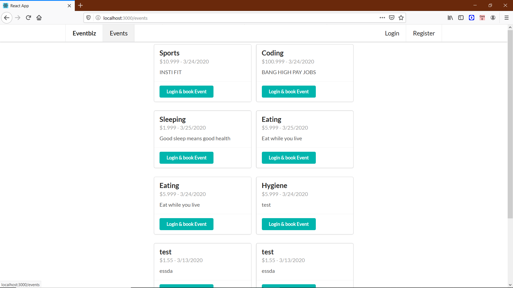
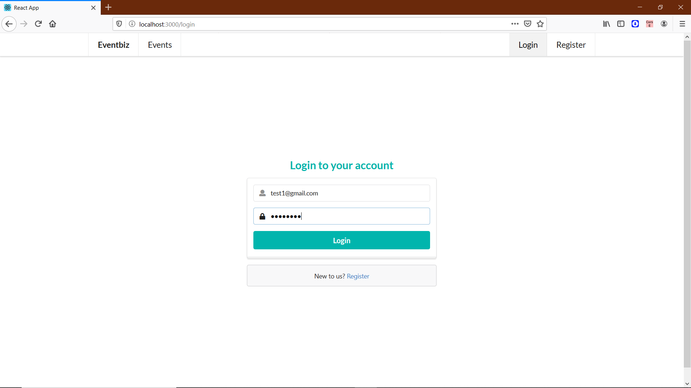
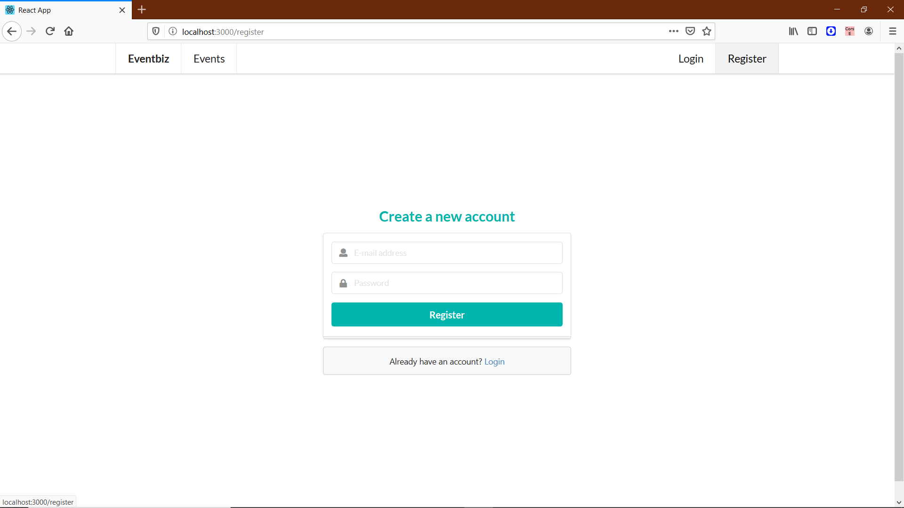
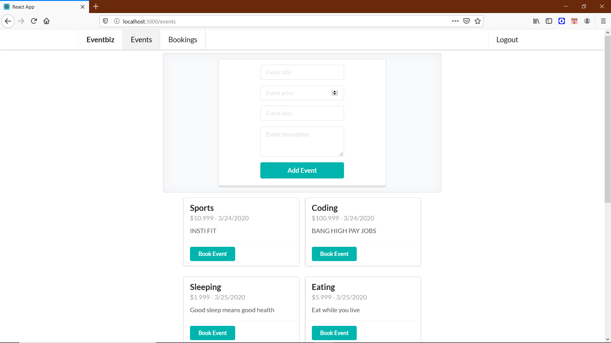
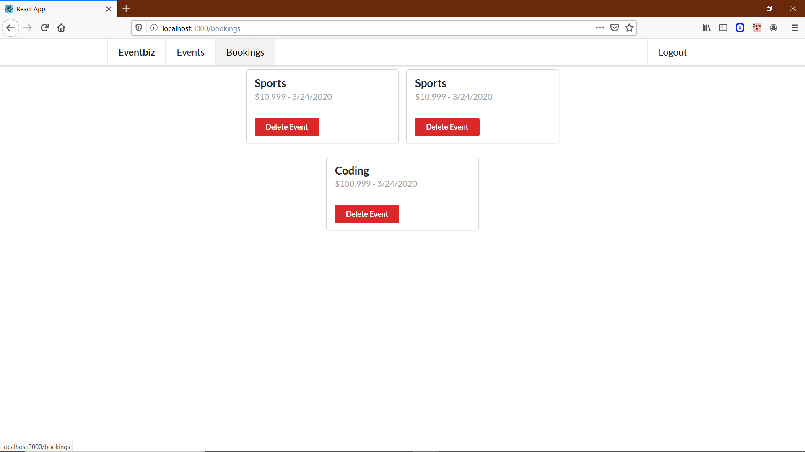

# EventBiz

[](https://ysskrishna.space)

A shared events app where users can add their own events and book other users events.

## Backend Express + GraphQl + MongoDB
Clone the git repo and install the dependencies
```sh
npm i 
```

Create a ENV variables MONGO_URI, JWT_SECRET_KEY, JWT_EXPIRATION_TIME
```sh
MONGO_URI = "mongodb://localhost:27017/testDB"
JWT_SECRET_KEY = "ultimatesecret"
JWT_EXPIRATION_TIME = 1
```

Run Backend in development mode
```sh
npm run dev
```
By default the backend will be running in port: 8000

## Frontend React + Semantic-UI-React
Install frontend dependencies. 
```sh
cd client
npm i 
```

Run Frontend in development mode.
```sh
cd client
npm start
```

By default the Frontend will be running in port: 3000

# Images

## Landing Page:


## Login:


## Register:


## Dashboard:


## User Bookings:


## Built and maintained by

EventBiz is built and maintained by:

| | Name | GitHub | Role |
|---|------|--------|------|
|  | **Y. Siva Sai Krishna** | [@ysskrishna](https://github.com/ysskrishna) | Creator |

## Support

If you find this project helpful:

- ⭐ Star the repository
- 🐛 [Report issues](https://github.com/ysskrishna/graphql-react-event-booker/issues)
- 🔀 Submit pull requests
- 💝 [Sponsor on GitHub](https://github.com/sponsors/ysskrishna)

---

<p align="left">
  <a href="https://github.com/ysskrishna">Author's GitHub</a> •
  <a href="https://linkedin.com/in/ysskrishna">Author's LinkedIn</a> •
  <a href="https://ysskrishna.space">Author's site</a> •
  <a href="https://github.com/ysskrishna/graphql-react-event-booker/issues">Report Issues</a>
</p>
